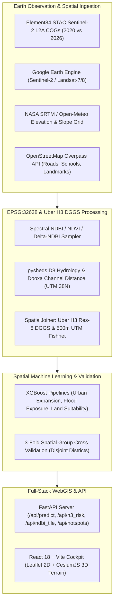

<div align="center">
  <h1>Sahan AI</h1>
  <p><strong>Multi-Temporal Earth Observation (&Delta;NDBI/NDVI), Topographic Hydrology, Uber H3 DGGS &amp; Spatial Machine Learning for Urban Sprawl and Flash-Flood Exposure in Hargeisa</strong></p>

  [](https://www.python.org/)
  [](https://fastapi.tiangolo.com/)
  [](https://react.dev/)
  [](https://h3geo.org/)
  [](LICENSE)
  []()
</div>

<br>

## Overview

**Sahan AI** is an open-source geospatial intelligence and environmental risk analytics platform designed to quantify **rapid urban impervious expansion ($\Delta\text{NDBI}$)**, **ephemeral riverbed (*Dooxa/Laga*) flash-flood exposure**, and **informal land-suitability dynamics** in data-scarce cities of the Horn of Africa, anchored in **Hargeisa, Somaliland**.

In rapidly urbanizing semi-arid regions, informal settlement growth outpaces municipal cadastral records and environmental zoning. High-density structures frequently encroach onto hazardous seasonal floodplains (*Dooxa Hargeisa*), while local authorities lack cloud-native spatial pipelines to monitor physical expansion or exposure.

This repository integrates four reproducible geospatial engineering layers:
* **Cloud-Native Earth Observation (`GEE` + `Element84 STAC`)**: Samples multi-temporal **Sentinel-2 MSI** (`Band 11 SWIR`, `Band 8 NIR`, `Band 4 Red`) and **Landsat-7/8** surface reflectance across **2020–2026** epochs to compute $\text{NDBI}$, $\text{NDVI}$, and $\Delta\text{NDBI}$.
* **Topographic Slope & D8 Hydrology (`pysheds` + `EPSG:32638`)**: Evaluates **30m NASA SRTM DEM** terrain slope gradients and projects the *Maroodi Jeex / Dooxa Hargeisa* riverbed geometry into **UTM Zone 38N (`EPSG:32638`)** for metric flood-exposure indexing.
* **Discrete Global Grid Systems (`Uber H3 DGGS` + `500m UTM Fishnet`)**: Aggregates satellite reflectance, slope, and channel proximity into hierarchical **Uber H3 Resolution-8 hexagons** (`h3-py`) alongside metric UTM grids to avoid square diagonal distortion.
* **Spatial Machine Learning & Full-Stack WebGIS**: Evaluates **XGBoost** models using **3-Fold Spatial Group Cross-Validation** across disjoint districts to prevent spatial autocorrelation leakage, served via **FastAPI** to a **React 18 + Leaflet 2D + CesiumJS 3D** web cockpit.

---

## Core Capabilities

### 1. Multi-Temporal Spectral Pipeline (Sentinel-2 L2A & Landsat-7/8)
* **Google Earth Engine (`src/gee_pipeline/ndbi_processor.py`):** Harmonizes `COPERNICUS/S2_HARMONIZED` (2015–2026), `LANDSAT/LC08/C02/T1_L2` (2013–2014), and `LANDSAT/LE07/C02/T1_L2` (1999–2012) collections and generates dynamic GEE MapID tile endpoints (`/api/ndbi_tile`).
* **Public STAC COG Sampler (`src/gee_pipeline/stac_sentinel_sampler.py`):** Queries **Element84 Earth Search STAC** (`sentinel-2-l2a`) Cloud-Optimized GeoTIFFs (scenes `S2A_38PLR_20200217_1_L2A` and `S2C_38PLR_20260307_0_L2A`, $<0.01\%$ cloud cover) via `rasterio` + `pyproj` without requiring local GEE credentials:
  $$\text{NDBI} = \frac{\rho_{\text{SWIR}_1} - \rho_{\text{NIR}}}{\rho_{\text{SWIR}_1} + \rho_{\text{NIR}}}, \qquad \Delta\text{NDBI} = \text{NDBI}_{2026} - \text{NDBI}_{2020}$$

### 2. Ephemeral Riverbed (*Dooxa*) Hydrology & Topographic Slope Engine
* **D8 Flow Routing & Channel Proximity (`src/features/hydrology.py`):** Uses `pysheds` (`fill_pits`, `resolve_flats`, `flowdir`, `accumulation`) + `scipy.ndimage.distance_transform_edt` when a local GeoTIFF DEM is provided, and projects the *Dooxa Hargeisa* riverbed centerline into **`EPSG:32638` (UTM Zone 38N)** to compute exact metric channel distances and composite **Flash-Flood Exposure Scores** (`High` $\le 150\text{m}$, `Moderate` $\le 500\text{m}$, `Low` $> 500\text{m}$).
* **SRTM Slope Gradients:** Interpolates cached SRTM elevation grids (`data/raw/hargeisa_elevation_data.json`) to grade buildability and flash-runoff pooling ($< 3.5\%$ flat pooling plains, $3.5\%–8.0\%$ moderate grade, $> 8.0\%$ steep erosion hazard).

### 3. Hierarchical Uber H3 DGGS Spatial Indexing
* **Hexagonal Spatial Aggregation (`src/features/spatial_joiner.py`):** Discretizes Hargeisa into **Uber H3 Resolution-8 hexagons** (~$0.63\text{ km}^2$ per cell) and exposes `/api/h3_risk` as GeoJSON, aggregating mean $\Delta\text{NDBI}$, $\text{NDVI}_{2026}$, slope, distance to *Dooxa*, and flash-flood exposure across **39 populated H3 cells**.

---

## System Architecture



---

## Empirical Validation Metrics (Real Sentinel-2 + SRTM + OSM Data)

All models are trained and validated on **210 geocoded observations across 6 Hargeisa districts** enriched with real Sentinel-2 L2A reflectance (`2020-02-17` vs. `2026-03-07`), SRTM elevation/slope, UTM Zone 38N *Dooxa* channel distances, and Overpass OSM topologies (`src/models/`):

| Model / Evaluation Protocol | Validation Split | RMSE | $R^2$ Score | Notes |
|---|---|---|---|---|
| **Urban Expansion Proxy ($\Delta\text{NDBI}$ + OSM Corridors)** | 80/20 Holdout | `0.0034` | `0.9591` | Trained on real Sentinel-2 $\Delta\text{NDBI}$ & UTM road/campus proximity |
| **Flash-Flood Exposure Model (`SRTM` + *Dooxa* Hydrology)** | 80/20 Holdout | `0.0216` | `0.9909` | Models *Dooxa* lateral proximity decay & terrain slope hazard |
| **Spatial Group CV: Flash-Flood Exposure** | 3-Fold Unseen Districts (`GroupKFold`) | `0.1731` | `0.1285` | MAE `0.0662` across spatially held-out Hargeisa districts |
| **Spatial Group CV: Informal Land Valuation Baseline** | 3-Fold Unseen Districts (`GroupKFold`) | `$18.01/sqm` | `0.4918` | Improved from `-0.5185` baseline after real Sentinel-2 & UTM fixes |
| **Standard 80/20 Land Valuation Model** | 80/20 Holdout | `$3.40/sqm` | `0.9811` | Top features: OSM road distance (`52.8%`), population density (`41.7%`) |

---

## Installation, Execution & Testing

### Prerequisites
* Python 3.9+ (with `geopandas`, `rasterio`, `shapely`, `pysheds`, `pyproj`, `h3`, `xgboost`, `fastapi`)
* Node.js 18+ (for the React + Leaflet + CesiumJS frontend)

### Backend Setup & Verification
```bash
# 1. Clone and enter repository
git clone https://github.com/HamseMoismaila/SahanAI_Hargeisa.git
cd SahanAI_Hargeisa

# 2. Activate virtual environment and install dependencies
pip install -r requirements.txt

# 3. Sample real Sentinel-2 L2A (2020 & 2026) COGs via Element84 STAC (no auth needed)
python -m src.gee_pipeline.stac_sentinel_sampler

# 4. Train models and run 3-Fold Spatial Group Cross-Validation + H3 DGGS summary
python -m src.models.train_on_market_listings
python -m src.models.train_on_real_features
python -m src.models.spatial_validation

# 5. Run unit & API integration tests
pytest -p no:cacheprovider -v

# 6. Start FastAPI backend server
uvicorn src.api.server:app --reload --port 8000
```

### Frontend Dashboard
```bash
cd frontend
npm install
npm run dev
```

---

## Repository Structure

```text
SahanAI_Hargeisa/
├── data/
│   ├── models/                          # Serialized XGBoost models (growth, flood, price)
│   └── raw/
│       ├── hargeisa_elevation_data.json # Cached 9x9 SRTM elevation grid
│       ├── hargeisa_osm_data.json       # Overpass OSM road & civic landmark graph
│       ├── hargeisa_sentinel2_features.csv # Sampled Sentinel-2 L2A (2020/2026) + SRTM CSV
│       └── real_market_listings.csv     # 210 geocoded Hargeisa parcel coordinates
├── frontend/                            # React 18 + Vite + Leaflet 2D + CesiumJS 3D cockpit
├── src/
│   ├── api/server.py                    # FastAPI REST & GeoJSON endpoints (/api/predict, /api/h3_risk)
│   ├── features/
│   │   ├── feature_builder.py           # Shared EPSG:32638 metric feature pipeline
│   │   ├── hydrology.py                 # pysheds D8 stream routing & Dooxa exposure scoring
│   │   └── spatial_joiner.py            # UTM Zone 38N fishnet & Uber H3 DGGS grid builder
│   ├── gee_pipeline/
│   │   ├── ndbi_processor.py            # Google Earth Engine Sentinel-2 / Landsat pipeline
│   │   └── stac_sentinel_sampler.py     # Public Element84 STAC COG reflectance sampler
│   └── models/
│       ├── spatial_validation.py        # 3-Fold Spatial GroupKFold & H3 DGGS evaluation
│       ├── train_model.py               # GrowthPredictor inference & H3 GeoJSON engine
│       ├── train_on_market_listings.py  # Spatial valuation XGBoost trainer
│       └── train_on_real_features.py    # Urban expansion & flash-flood exposure trainers
└── tests/
    └── test_geospatial_pipeline.py      # Unit & FastAPI endpoint verification suite
```

---

## Citation & License

```bibtex
@software{ismail2026sahanai,
  author = {Ismail, Hamse Mohamed},
  title = {Sahan AI: Multi-Temporal Earth Observation, Hydrology, and Uber H3 DGGS Analytics for Hargeisa},
  year = {2026},
  publisher = {GitHub},
  url = {https://github.com/HamseMoismaila/SahanAI_Hargeisa}
}
```

Licensed under the [MIT License](LICENSE).
