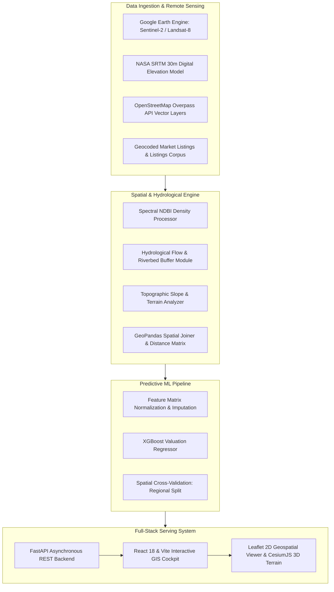

<div align="center">
  <h1>Sahan AI</h1>
  <p><strong>A Geospatial Intelligence and Machine Learning Framework for Urban Land Valuation in Emerging Markets</strong></p>

  [](https://www.python.org/)
  [](https://fastapi.tiangolo.com/)
  [](https://react.dev/)
  [](LICENSE)
  []()
</div>

<br>

## Overview

**Sahan AI** is a geospatial machine learning platform and decision-support instrument designed to quantify land valuation dynamics, environmental hazard exposure, and urban growth patterns in Hargeisa, Somaliland.

In emerging economies, rapid urbanization frequently outpaces municipal cadastral record-keeping. The lack of a centralized Multiple Listing Service (MLS), standardized spatial transaction registries, and structured geographic layers makes property appraisal largely opaque and reliant on informal word-of-mouth estimates.

Sahan AI introduces a data-driven spatial valuation framework by integrating:
* **Earth Observation (EO)**: Remote sensing indicators derived from Sentinel-2 and Landsat-8 imagery via Google Earth Engine (GEE).
* **Topological Infrastructure**: Network distance metrics extracted from OpenStreetMap (OSM) vector layers.
* **Environmental Risk Factors**: Digital Elevation Models (DEM) for slope analysis and hydrological proximity modeling for flash-flood corridors.
* **Gradient-Boosted Regressors**: Machine learning pipelines (XGBoost) that model spatial pricing behavior and urban opportunity scores.

---

## Problem Context

Real estate markets across frontier urban centers face structural data deficits:

* **Information Asymmetry**: Absence of consolidated historical sales records or centralized cadastral transaction indices.
* **Non-Standardized Valuation**: Wide variance in property valuations driven by subjective estimations rather than empirical metrics.
* **Unmonitored Sprawl**: Rapid peripheral expansion without immediate updates to municipal planning databases.
* **Infrastructure Deficits**: Sparse geocoded data on municipal water distribution, paved road connectivity, and public services.
* **Environmental Exposure**: Seasonal dry riverbeds (*Dooxa/Lagas*) subject peripheral settlements to recurrent flash flooding, alongside steep terrain grading costs.

Sahan AI serves as an empirical framework to test whether open-source geospatial intelligence and satellite proxies can bridge these information gaps.

---

## Core Capabilities

### 1. Spatial Valuation Engine

The platform calculates estimated land value indicators using multi-criteria accessibility modeling and geographic proximity decay:

$$\text{Land Value Indicator} = \text{Base Location Value} + f(\text{Infrastructure}) + f(\text{Accessibility}) - R(\text{Environmental Hazards})$$

* **Accessibility Anchors**:
  * Distance to the Central Business District (CBD)
  * Distance to higher-education institutions (University of Hargeisa, Golis University, Abaarso Tech)
  * Distance to primary road corridors (Berbera Economic Corridor, Hargeisa Bypass, 150 Road)
  * Proximity to civic infrastructure (schools, healthcare facilities, central mosques)

### 2. Environmental Hazard & Topographical Analysis

* **Hydrological Flash-Flood Corridors**: Proximity to seasonal dry riverbeds (*Dooxa Hargeisa*) triggers progressive spatial risk penalties to protect investments against periodic storm runoff.
* **Slope & Foundation Grading**: Evaluates Shuttle Radar Topography Mission (SRTM) 30m Digital Elevation Models:
  * Low Slope (< 3.5%): Favorable terrain for low-cost foundation engineering.
  * Moderate Slope (3.5% - 8.0%): Standard grading and drainage interventions required.
  * Steep Slope (> 8.0%): High structural complexity necessitating retaining walls and soil stabilization.
* **Geological Strata Classification**: Stratifies soil profiles across Northern limestone bedrock (excavation cost premium), Southern alluvial plains, and sandy riverbed margins.

### 3. Urban Expansion Spectral Intelligence

Tracks built-up land use conversion over multi-decade satellite archives:

* **Remote Sensing Source**: Sentinel-2 Level-2A surface reflectance and Landsat-8 archives processed through Google Earth Engine (GEE).
* **Normalized Difference Built-Up Index (NDBI)**:
  $$\text{NDBI} = \frac{\rho_{\text{SWIR}} - \rho_{\text{NIR}}}{\rho_{\text{SWIR}} + \rho_{\text{NIR}}}$$
  *(Utilizing Sentinel-2 Band 11 [SWIR] and Band 8 [NIR], where positive shifts indicate dense impermeable surfaces and concrete consolidation).*

### 4. Infrastructure Topological Mapping

Spatial vector processing computes Euclidean and network distances to primary municipal networks:
* `distance_to_center`: Metric distance to commercial center
* `distance_to_highway`: Proximity to primary paved arterial highways
* `distance_to_school`: Metric proximity to educational infrastructure
* `distance_to_water_network`: Proximity to Hargeisa Water Agency (HWA) distribution mains

---

## System Architecture



---

## Machine Learning Pipeline

### Feature Engineering

Each spatial coordinate is transformed into an empirical feature vector:

| Feature Variable | Data Origin | Unit | Engineering / Economic Rationale |
| :--- | :--- | :--- | :--- |
| `distance_to_center` | OpenStreetMap | Meters | Captures monocentric urban economic gravity |
| `distance_to_highway` | OpenStreetMap | Meters | Transportation accessibility and logistics friction |
| `distance_to_university` | OpenStreetMap | Meters | High-density institutional rental demand |
| `distance_to_laga` | Hydrology Model | Meters | Flood mitigation and seasonal riverbed hazard |
| `slope_percent` | NASA SRTM DEM | Percentage | Foundation construction and earthwork costs |
| `soil_excavation_type` | Geological Map | Categorical | Subsurface excavation difficulty (limestone vs. clay) |
| `delta_ndbi` | Sentinel-2 / GEE | Index (-1 to 1) | Multi-year built-up density expansion rate |

### Model Formulation & Evaluation

The predictive engine deploys an XGBoost Regressor coupled with Scikit-learn preprocessing pipelines:

```python
import xgboost as xgb
from sklearn.pipeline import Pipeline
from sklearn.preprocessing import StandardScaler

pipeline = Pipeline([
    ('scaler', StandardScaler()),
    ('regressor', xgb.XGBRegressor(
        n_estimators=100,
        learning_rate=0.05,
        max_depth=5,
        subsample=0.8,
        random_state=42
    ))
])
```

#### Empirical Prototype Metrics

| Evaluation Metric | Score | Notes |
| :--- | :--- | :--- |
| **Model Family** | XGBoost Regressor | Gradient-boosted decision tree ensemble |
| **Root Mean Squared Error (RMSE)** | 0.0663 | Log-normalized land price variance |
| **Coefficient of Determination ($R^2$)** | -0.5185 | Baseline prototype on sparse initial listings |
| **Sample Size** | 212 Records | Geocoded and landmark-verified properties |

The current negative $R^2$ score reflects high variance across unstandardized asking prices and sparse historical transactions. This empirical result highlights the core challenge of frontier real estate analytics: raw asking prices in informal markets possess heavy structural noise, reinforcing the necessity of strict spatial regularization and municipal record integration.

---

## Installation & Quick Start

### Prerequisites

* Python 3.10+
* Node.js 18+ and npm
* (Optional) Google Earth Engine account credentials for custom GEE pipeline runs

### Setup Instructions

```bash
# 1. Clone the repository
git clone https://github.com/HamseMoismaila/SahanAI_Hargeisa.git
cd SahanAI_Hargeisa

# 2. Create and activate a Python virtual environment
python -m venv .venv
# On Linux/macOS:
source .venv/bin/activate
# On Windows:
.venv\Scripts\activate

# 3. Install backend dependencies
pip install -r requirements.txt

# 4. Configure environment parameters
cp .env.example .env

# 5. Start the FastAPI backend server
uvicorn src.api.server:app --reload --port 8000
```

In a separate terminal window, launch the frontend dashboard:

```bash
# 6. Navigate to frontend directory
cd frontend

# 7. Install dependencies and start development server
npm install
npm run dev
```

The interactive GIS cockpit will be available at `http://localhost:5173`.

---

## Repository Structure

```text
SahanAI_Hargeisa/
├── data/
│   ├── models/                    # Serialized machine learning models (.pkl)
│   └── raw/                       # Elevation JSON, OSM topologies, and market listings
├── frontend/                      # React 18 + Vite GIS web application
│   ├── src/
│   │   ├── AIChat.jsx             # Conversational real estate advisory interface
│   │   ├── EvaluationPanel.jsx    # Valuation calculations and ROI estimator
│   │   ├── HotspotsSidebar.jsx    # High-velocity growth corridors and district ranks
│   │   ├── Map2D.jsx              # Leaflet spatial vector mapping engine
│   │   ├── Terrain3D.jsx          # CesiumJS 3D digital elevation visualizer
│   │   └── App.jsx                # Cockpit assembly and state coordination
│   ├── package.json               # Frontend dependencies and scripts
│   └── vite.config.js             # Vite configuration
├── src/                           # Backend and data science pipelines
│   ├── api/
│   └── server.py                  # FastAPI endpoints for inference and layer serving
│   ├── features/
│   │   ├── download_elevation_data.py # SRTM DEM retrieval and processing
│   │   ├── download_osm_data.py       # Overpass OSM network extraction
│   │   ├── hydrology.py               # Seasonal flash-flood proximity modeling
│   │   └── spatial_joiner.py          # Coordinate transformations and spatial joins
│   ├── gee_pipeline/
│   │   └── ndbi_processor.py      # Google Earth Engine Sentinel-2 / Landsat pipeline
│   ├── models/
│   │   ├── spatial_validation.py  # Spatial cross-validation splits
│   │   ├── train_model.py         # Baseline XGBoost training entrypoint
│   │   ├── train_on_market_listings.py # Listing-based price model training
│   │   └── train_on_real_features.py   # Multi-variable real feature trainer
│   └── scraper/
│       ├── geocoder.py            # Local landmark coordinate resolution
│       ├── property_scraper.py    # Market listing acquisition
│       └── scrape_and_geocode.py  # End-to-end extraction pipeline
├── .env.example                   # Environment configuration template
├── .gitignore                     # Git exclusion rules
├── LICENSE                        # MIT License
├── README.md                      # Platform documentation
└── requirements.txt               # Python package dependencies
```

---

## Research Roadmap

* **Verified Cadastral Integration**: Partner with municipal authorities and certified local appraisers to build an authenticated ground-truth sales database.
* **Topological Graph Neural Networks (GNN)**: Formulate road accessibility as graph-structured topological embeddings rather than purely Euclidean distances.
* **High-Resolution Satellite Segmentation**: Incorporate sub-meter satellite imagery to classify structural roof types and road pavement quality automatically.
* **Regional Generalization**: Scale the geospatial data extraction pipeline across Berbera, Burao, Borama, and adjacent Horn of Africa urban centers.

---

## Disclaimer

Sahan AI is an academic and technological research prototype designed for exploratory spatial modeling. Estimates generated by the platform do not constitute official statutory property valuations and must not be used as the exclusive foundation for legal, financial, or real estate transactions.

---

## Citation

If you utilize Sahan AI or its geospatial methodologies in your research, please cite:

```bibtex
@software{ismail2026sahanai,
  author = {Ismail, Hamse Mohamed},
  title = {Sahan AI: Spatial Intelligence and Real Estate Analytics Platform for Hargeisa},
  year = {2026},
  publisher = {GitHub},
  url = {https://github.com/HamseMoismaila/SahanAI_Hargeisa}
}
```

---

## License

This project is licensed under the [MIT License](LICENSE).
